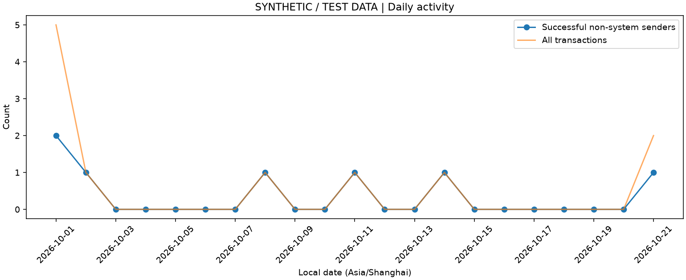
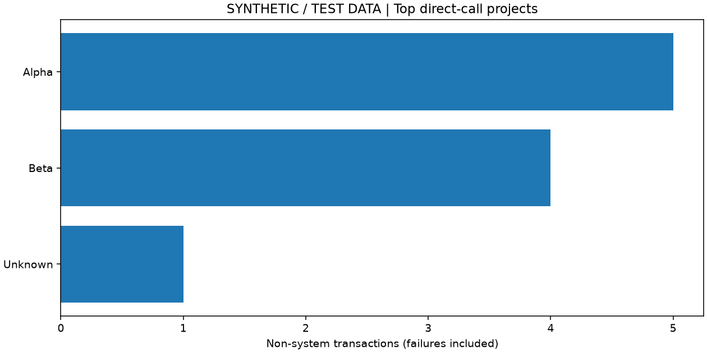

# opBNB activity report

**SYNTHETIC / TEST DATA — 合成测试数据，非主网统计**

Run: `final-smoke`. Dataset: `..` relative to this report. Timezone: **Asia/Shanghai**.
UTC window: **[2026-09-30T16:00:00+00:00, 2026-10-21T16:00:00+00:00)**; blocks **[100, 106)**.
Dataset version: `ef49060997212b96d30931b244c7fbb24c9e93c4d1e492bdb943548aa4f51bba`. Labels version: `a9f9bb0d2dda71b7de6c9acc2e76dfa289251d9fbb6e12ce2fb3e355322c009d`.
Assets version: `5aa3854ef56eaa633a5b617b998394872cc3ef3312dca1349f7d8674f9291298`. Quality: **PASS** for declared manifest range.

## Activity

| Metric | Value |
|---|---:|
| Transactions (all) | 11 |
| System L1 attributes transactions | 1 |
| Successful non-system transactions | 8 |
| Failed non-system transactions | 2 |
| Unique successful non-system sending addresses | 5 |
| Unique all non-system sending addresses | 5 |
| Unknown project transactions (non-system) | 1 |
| Unknown historical recipient kind transactions | 10 |
| Known project coverage | 0.9 |
| Full fee coverage | 0.8181818181818182 |
| L2 fee coverage | 1.0 |
| Unknown total-fee transactions | 2 |
| Known total fees (wei, includes failures) | 336800 |
| Partial L2 fees (wei, includes failures) | 378000 |
| Successful top-level native value (wei) | 1000000000000000000000000000000000000000000081 |
| Successful top-level native value (BNB) | 1000000000000000000000000000.000000000000000081 |
| Ambiguous/NFT-like Transfer logs excluded | 1 |
| Unverified Transfer logs excluded | 0 |

Verified fungible token raw sums: `{"0x00000000000000000000000000000000000001f4": "10000000000000000000000000000000000000001"}`.
Verified fungible token scaled sums: `{"0x00000000000000000000000000000000000001f4": "10000000000000000000000.000000000000000001"}`.
Identified-project contributions / all non-system transactions: top-1=0.5, top-5=0.9, top-10=0.9, HHI=0.41000000000000003. Unknown share=0.1 is separate and is not treated as one project.
Top 1% successful senders (ceil, 1 addresses) contribute 0.5 of all successful non-system transactions; calculated from the full dataset.

## Definitions and limits

- Main active measure: distinct sending addresses of successful non-system transactions in each local calendar day; supplemental measure includes failed non-system senders. Addresses are not people.
- `daily.csv` includes exact successful top-level native value, known full fees, partial L2 fees, missing counts and fee coverage; zero-transaction days have undefined fee coverage.
- Whole-window, weekly (Monday start), monthly addresses deduplicate within each period. Partial edge periods are retained. Contract/project successful senders deduplicate after direct-recipient grouping.
- Project ranking uses direct calls only: at most one project per transaction, failed calls included, system calls excluded. Unknown remains visible. Internal calls, proxy implementation ownership and indirect routing are not inferred.
- `contracts.csv` ranks direct recipients; unknown historical code means the recipient may be a contract or EOA. Empty input never proves EOA. Technical/business categories are only supplied labels; unsupported classifications remain unknown.
- System identification requires deposit type 0x7e AND exact configured L1 attributes depositor AND configured protocol recipient. User deposits remain non-system.
- D1/D7 retention uses each address's first observed successful non-system day within this window as cohort; return is a successful non-system transaction on that exact later local day. Only complete, mature cohort/target days are included. Prior history before the window is unknown.
- Native value includes successful non-system top-level `value` only; it is not economic trading volume and may include user deposits or self-transfers. No internal native transfers are measured.
- Token amounts require explicitly verified fungible address and supplied decimals; three-topic Transfer events only. NFT-like four-topic or ambiguous events are excluded. Transfer totals are event movement, not economic volume.
- Full fee = observed L2 gasUsed × effectiveGasPrice + observed l1Fee only when BOTH components exist; unknown L1 never becomes zero. Known subtotal is a partial-coverage sum. Failure fees are included where fields are known. No unverified total-fee fields are trusted.
- Unsupported: prices, USD value, TVL, DEX/bridge volume, bots, human-user counts, trace-based attribution and comprehensive business-type classification.
- Synthetic sparse chain blocks simulate irregular timestamps. Zero days in a synthetic run describe the fixture only. Capability samples do not establish live throughput or provider coverage.

## Tables and charts

`daily.csv`, `contracts.csv`, `projects.csv`, `senders.csv`, `weekly.csv`, `monthly.csv`, `retention.csv`.

